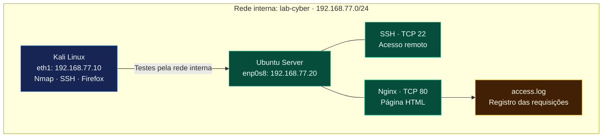
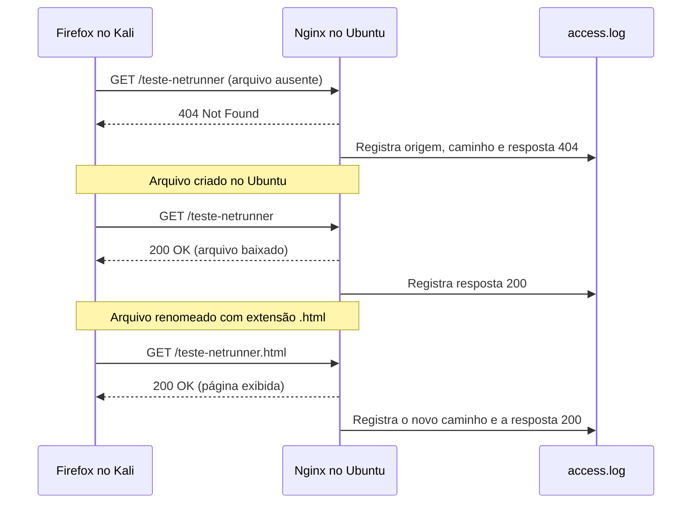

<div align="center">

# Laboratório de Redes e Segurança

**Redes · Linux · SSH · Nginx · Logs HTTP**

Duas máquinas virtuais, uma rede interna e testes para entender como os serviços respondem.

[](#v2)
[](#ambiente)
[](#escopo)

[Resultados](#resultados) · [Mapa da rede](#mapa) · [V2 — Web e logs](#v2) · [V1 — Histórico](#v1) · [Ambiente](#ambiente)

</div>

---

Estudo prático com Kali Linux e Ubuntu Server no VirtualBox. Comecei configurando a rede e o acesso SSH. Na v2, instalei o Nginx, comparei o comportamento da porta 80 com o serviço ativo e parado e acompanhei requisições no log do servidor.

**Status:** v1 e v2 concluídas dentro do escopo descrito abaixo.

<a id="resultados"></a>
## Resultados em uma leitura

| O que testei | O que observei |
| :--- | :--- |
| Comunicação entre as VMs | O Ubuntu respondeu aos quatro pedidos de ping do Kali. |
| Acesso SSH | Consegui executar comandos no Ubuntu a partir do Kali. |
| Nginx ativo | Porta 80 aberta e página padrão acessível. |
| Nginx parado | Porta 80 fechada e falha de conexão no navegador. |
| Nginx iniciado novamente | Estado `active` e página acessível novamente. |
| Caminho inexistente | Resposta HTTP `404` registrada no log. |
| Arquivo disponível | Resposta HTTP `200`; após usar `.html`, a página foi exibida diretamente. |

<a id="mapa"></a>
## Mapa da rede



Cada VM também tem um adaptador NAT separado para conexões de saída, omitido do desenho. Os testes entre Kali e Ubuntu usaram a rede interna. O desenho não representa segmentação entre os serviços do Ubuntu.

<a id="v2"></a>
## V2 — Serviço web e registros HTTP

**Pergunta do exercício:** o que muda na porta, no navegador e no log quando altero o serviço ou o arquivo solicitado?

### Serviço ativo e parado

| Etapa | Porta TCP 80 | Navegador |
| :--- | :--- | :--- |
| Antes de instalar o Nginx | `closed` | Não testado nessa etapa |
| Depois de instalar e iniciar | `open` | “Welcome to nginx!” |
| Depois de parar o Nginx | `closed` | Falha de conexão |
| Depois de iniciar novamente | Não repetido com Nmap nessa etapa | Página acessível novamente |

**O que aprendi:** parar o serviço não desinstala o programa. Nesse teste, isso interrompeu as conexões à porta 80. Uma porta aberta, por si só, não confirma uma vulnerabilidade.

### Do pedido à evidência



A página própria foi acessada em `http://192.168.77.20/teste-netrunner.html`.

**O que aprendi:** a porta 80 estava aberta tanto no `404` quanto no `200`. O código HTTP descreve a resposta ao pedido; o estado da porta descreve se há um serviço aceitando conexões.

<details>
<summary><strong>Ver evidências do log: antes e depois</strong></summary>

Trechos reais, abreviados após o campo de tamanho da resposta:

```text
192.168.77.10 - - [19/Oct/2026:12:57:43 +0000] "GET /teste-netrunner HTTP/1.1" 404 134
192.168.77.10 - - [19/Oct/2026:12:58:38 +0000] "GET /teste-netrunner HTTP/1.1" 200 221
192.168.77.10 - - [19/Oct/2026:13:00:51 +0000] "GET /teste-netrunner.html HTTP/1.1" 200 203
```

| Campo | Leitura neste laboratório |
| :--- | :--- |
| `192.168.77.10` | IP do Kali, que fez os pedidos. |
| `+0000` | Deslocamento UTC dos horários registrados no servidor. |
| `GET` | Método usado para solicitar o recurso. |
| `/teste-netrunner.html` | Caminho solicitado. |
| `404` / `200` | Não encontrado / requisição atendida com sucesso. |
| Número após o código | Quantidade de bytes do corpo da resposta registrada. |

Os tamanhos registrados variaram entre os pedidos. A causa dessa diferença não foi investigada; renomear um arquivo, sozinho, não modifica seu conteúdo.

</details>

<details>
<summary><strong>Ver procedimentos e comandos da v2</strong></summary>

### Objetivo

Observar como iniciar e parar um servidor web afeta a porta TCP 80 e o acesso pelo navegador.

### Instalação no Ubuntu

Os comandos foram executados no Ubuntu por uma sessão SSH iniciada no Kali:

```bash
sudo apt update
sudo apt install nginx
systemctl is-active nginx
```

A consulta retornou `active`.

### Verificação pelo Kali

```bash
nmap -sV -p 22,80 192.168.77.20
```

A porta 80, que estava fechada no teste da primeira versão, passou a aparecer como aberta.

No navegador do Kali, o endereço abaixo exibiu a página padrão “Welcome to nginx!”:

```text
http://192.168.77.20
```

### Teste com o serviço parado

Na sessão SSH do Ubuntu:

```bash
sudo systemctl stop nginx
```

Após repetir a verificação pelo Kali, a porta 80 apareceu como fechada. O navegador também deixou de acessar a página.

### Reinício do serviço

No Ubuntu:

```bash
sudo systemctl start nginx
systemctl is-active nginx
```

O estado voltou a ser `active`, e a página ficou acessível novamente no navegador do Kali.

### Resultados observados

| Situação | Porta TCP 80 | Acesso pelo navegador |
| :--- | :--- | :--- |
| Antes da instalação | Fechada | Não testado nessa etapa |
| Nginx em execução | Aberta | Página padrão exibida |
| Nginx parado | Fechada | Falha de conexão |
| Nginx iniciado novamente | Não verificada novamente com Nmap | Página acessível novamente |

### Aprendizado

Neste exercício, observei a relação entre um serviço em execução, uma porta aberta e o acesso à aplicação. Parar o Nginx interrompeu o acesso web sem desinstalar o programa.

### Página própria e análise dos registros HTTP

Acompanhei os acessos ao Nginx no terminal do Ubuntu:

```bash
sudo tail -f /var/log/nginx/access.log
```

No navegador do Kali, acessei `/teste-netrunner` antes de criar o arquivo. O servidor registrou:

```text
192.168.77.10 - - [19/Oct/2026:12:57:43 +0000] "GET /teste-netrunner HTTP/1.1" 404 134
```

Depois de criar o arquivo, o mesmo caminho passou a retornar `200`. Porém, o navegador baixou o arquivo em vez de exibir a página diretamente.

Renomeei o arquivo para incluir a extensão `.html`:

```bash
sudo mv /var/www/html/teste-netrunner /var/www/html/teste-netrunner.html
```

Ao acessar `http://192.168.77.20/teste-netrunner.html`, a página foi exibida diretamente no navegador. O log registrou:

```text
192.168.77.10 - - [19/Oct/2026:13:00:51 +0000] "GET /teste-netrunner.html HTTP/1.1" 200 203
```

Os trechos acima foram abreviados após o campo de tamanho da resposta.

#### O que observei

- O IP `192.168.77.10` identifica o Kali neste laboratório.
- `GET` indica o pedido de um recurso.
- `404` indicou que o caminho solicitado não foi encontrado.
- `200` indicou que a requisição foi atendida com sucesso.
- Um código `200` não garante que o navegador exibiu uma página: também ocorreu quando o arquivo foi baixado.

A porta 80 permaneceu aberta durante esses testes. A resposta HTTP mudou conforme o recurso solicitado estava disponível.

</details>

### Conclusão da v2

Consegui relacionar uma ação no servidor ao resultado visto pelo cliente e ao registro no log. Também encontrei um detalhe que não esperava: receber `200` não garantiu que o navegador exibisse a página, pois inicialmente ele baixou o arquivo. Após acrescentar `.html` ao nome, confirmei a exibição diretamente no navegador.

Os testes foram funcionais e de observação. Não fiz avaliação de vulnerabilidades, teste de força de senhas ou análise de exposição pela internet.

<a id="v1"></a>
## V1 — Rede interna e SSH

**Concluída.** Configurei a rede interna, corrigi a persistência do IPv4 do Kali, validei a comunicação com o Ubuntu e testei o acesso SSH. A porta 22 estava aberta e a 80, fechada nessa versão.

<details>
<summary><strong>Abrir diário completo da v1 — configuração, problema encontrado e testes</strong></summary>

### 01 — Preparação da máquina virtual

A máquina Kali Linux já existia de um curso anterior. Para iniciar este projeto:

1. O adaptador de rede foi alterado de **bridge** para **NAT**.
2. A máquina virtual foi iniciada.
3. O acesso à área de trabalho foi confirmado.

**Motivo da escolha:** utilizar o NAT nesta etapa inicial para permitir conexões de saída pela rede do computador hospedeiro. Naquela etapa, a rede interna ainda seria preparada; sua configuração está registrada na etapa 04.

### 02 — Identificação das interfaces

**Objetivo:** verificar quais interfaces existem, seus estados e endereços.

```bash
ip -br addr
```

**Resumo dos dados IPv4 observados:**

| Interface | Estado exibido | Endereço IPv4 | Interpretação |
| :--- | :--- | :--- | :--- |
| `lo` | `UNKNOWN` | `127.0.0.1/8` | Interface de loopback, usada na comunicação do sistema consigo mesmo. |
| `eth0` | `UP` | `10.0.2.15/24` | Interface ativa que conecta o Kali à rede virtual. |

A saída também apresentou endereços IPv6, que não foram analisados nesta etapa.

**Conclusão:** a interface `eth0` está ativa e possui um endereço IPv4 privado. Isso, isoladamente, não comprova acesso à internet.

### 03 — Identificação das rotas

**Objetivo:** descobrir a rede diretamente conectada e o caminho padrão para outras redes.

```bash
ip route
```

<details>
<summary><strong>Ver saída registrada</strong></summary>

```text
default via 10.0.2.2 dev eth0 proto dhcp src 10.0.2.15 metric 100
10.0.2.0/24 dev eth0 proto kernel scope link src 10.0.2.15 metric 100
```

</details>

#### Interpretação

| Trecho da saída | Significado |
| :--- | :--- |
| `default via 10.0.2.2` | Define o gateway usado quando não existe uma rota mais específica para o destino. |
| `dev eth0` | Indica a interface utilizada pela rota. |
| `src 10.0.2.15` | Indica o endereço de origem preferido nessa rota. |
| `10.0.2.0/24` | Identifica a rede diretamente conectada. |
| `proto dhcp` | Indica que a rota padrão foi configurada por DHCP. |

**Conclusão:** o Kali possui uma rota direta para `10.0.2.0/24` e uma rota padrão pelo gateway `10.0.2.2`.

### 04 — Configuração da rede interna

**Objetivo:** preparar uma interface dedicada à comunicação entre as máquinas do laboratório.

Com o Kali desligado, o Adaptador 2 do VirtualBox foi habilitado em modo **Rede Interna**, com o nome `lab-cyber`. O Adaptador 1 permaneceu em NAT.

No Kali, a segunda interface foi identificada como `eth1`.

#### Problema encontrado

O endereço configurado com `ip addr add` apareceu inicialmente, mas não permaneceu aplicado. Na verificação seguinte:

- A interface `eth1` estava sem IPv4.
- O NetworkManager indicava estado `disconnected`, sem conexão ativa.
- A rota da rede do laboratório não estava presente.

Esses resultados confirmaram a ausência da configuração, mas não determinaram a causa exata de sua remoção.

#### Configuração permanente

Foi criado um perfil no NetworkManager com endereço IPv4 manual e ativação automática:

```bash
sudo nmcli connection add type ethernet ifname eth1 con-name lab-cyber ipv4.method manual ipv4.addresses 192.168.77.10/24 ipv4.never-default yes connection.autoconnect yes
```

Em seguida, o perfil foi ativado:

```bash
sudo nmcli connection up lab-cyber
```

A opção `ipv4.never-default yes` impede que esse perfil seja utilizado como rota padrão IPv4.

#### Validação após reiniciar

Comando:

```bash
ip -4 -br addr
```

Resultado:

```text
lo               UNKNOWN        127.0.0.1/8
eth0             UP             10.0.2.15/24
eth1             UP             192.168.77.10/24
```

Comando:

```bash
ip -4 route
```

Resultado:

```text
default via 10.0.2.2 dev eth0 proto dhcp src 10.0.2.15 metric 100
10.0.2.0/24 dev eth0 proto kernel scope link src 10.0.2.15 metric 100
192.168.77.0/24 dev eth1 proto kernel scope link src 192.168.77.10 metric 101
```

**Conclusão:** o endereço IPv4 e a rota da rede interna permaneceram após reiniciar. A rota padrão continuou pelo adaptador NAT. Naquele momento, a comunicação com outra máquina ainda não havia sido testada; a validação está registrada na etapa 06.

### 05 — Adição do servidor Ubuntu

Foi criada a máquina virtual `ubuntu-lab` com Ubuntu Server e dois adaptadores de rede:

| Interface | Modo no VirtualBox | IPv4 |
| :--- | :--- | :--- |
| `enp0s3` | NAT | `10.0.2.15/24` |
| `enp0s8` | Rede Interna — `lab-cyber` | `192.168.77.20/24` |

O serviço OpenSSH foi selecionado durante a instalação.

O endereço NAT coincide com o do Kali porque cada máquina utiliza uma instância separada do NAT padrão do VirtualBox. A comunicação entre as duas máquinas neste exercício utiliza a rede interna `192.168.77.0/24`.

### 06 — Teste de comunicação

No Kali:

```bash
ping -c 4 192.168.77.20
```

Foram observadas quatro respostas do Ubuntu, com tempos entre `0.251 ms` e `0.372 ms`.

**Conclusão:** houve comunicação entre Kali e Ubuntu pela rede interna. Esse teste não determina quais serviços estão disponíveis.

### 07 — Identificação do SSH

No Kali:

```bash
nmap -sV -p 22 192.168.77.20
```

Trecho do resultado:

```text
PORT   STATE SERVICE VERSION
22/tcp open  ssh     OpenSSH 10.2p1 Ubuntu 2ubuntu3.8 (Ubuntu Linux; protocol 2.0)
```

Interpretação:

- `-p 22` limita a verificação à porta 22.
- `-sV` tenta identificar o serviço e sua versão.
- `open` indica que a porta está aceitando conexões.
- O serviço identificado foi SSH, compatível com a instalação do OpenSSH no Ubuntu.

**Limitação:** apenas a porta TCP 22 foi examinada. A identificação de versão não comprova uma vulnerabilidade.

### 08 — Acesso remoto e confirmação do ambiente

A conexão foi iniciada no Kali:

```bash
ssh netrunner@192.168.77.20
```

Após entrar, foram executados os seguintes comandos na sessão remota:

```text
netrunner@ubuntu-lab:~$ whoami
netrunner
netrunner@ubuntu-lab:~$ hostname
ubuntu-lab
```

**Conclusão:** a sessão utilizou o usuário `netrunner` no servidor `ubuntu-lab`. O Kali atuou como cliente SSH; os comandos da sessão foram executados no Ubuntu.

### 09 — Comparação entre porta aberta e fechada

No Kali, foram verificadas duas portas TCP do Ubuntu:

```bash
nmap -sV -p 22,80 192.168.77.20
```

Resultado principal:

```text
PORT   STATE  SERVICE VERSION
22/tcp open   ssh     OpenSSH 10.2p1 Ubuntu 2ubuntu3.8 (Ubuntu Linux; protocol 2.0)
80/tcp closed http
```

#### Interpretação

- **22/TCP aberta:** o serviço SSH estava acessível. O acesso com o usuário do laboratório já havia sido validado na etapa anterior.
- **80/TCP fechada:** o alvo respondeu, mas não havia serviço aceitando conexões nessa porta.
- O nome `http` associa a porta 80 ao seu uso habitual; não comprova a presença de um servidor web.

### Conclusão da primeira versão

Foi montado um laboratório com Kali Linux e Ubuntu Server conectados pela rede interna `lab-cyber`.

Foram validados:

- Endereçamento e rotas do Kali, incluindo persistência após reiniciar.
- Comunicação do Kali com o Ubuntu.
- Identificação do serviço SSH.
- Acesso remoto autenticado e execução de comandos no Ubuntu.
- Comparação entre uma porta TCP aberta e uma fechada.

**Limitações:** a verificação de serviços ficou restrita às portas TCP 22 e 80. Não foram avaliadas vulnerabilidades, resistência das senhas ou configurações de segurança do SSH. Os resultados não permitem concluir que o servidor é seguro ou vulnerável.

</details>

<a id="ambiente"></a>
## Ambiente

| Componente | Configuração observada |
| :--- | :--- |
| Hospedeiro | Windows · 16 GB de RAM |
| Virtualização | VirtualBox |
| Máquinas virtuais | Kali Linux e Ubuntu Server |
| Rede dos testes | Rede Interna `lab-cyber` · `192.168.77.0/24` |
| Kali na rede interna | `eth1` · `192.168.77.10/24` |
| Ubuntu na rede interna | `enp0s8` · `192.168.77.20/24` |
| Adaptador 1 de cada VM | NAT, com instâncias separadas |
| IPv4 NAT observado em cada VM | `10.0.2.15/24` |
| Gateway NAT | `10.0.2.2` |
| Serviços estudados no Ubuntu | OpenSSH · TCP 22 / Nginx · TCP 80 |

O mesmo IPv4 NAT aparece nas duas VMs porque cada uma usa uma instância separada do NAT padrão do VirtualBox. A comunicação entre elas foi testada pelos endereços da rede interna.

## Progresso

| Versão | Entrega | Estado |
| :--- | :--- | :--- |
| V1 | Rede interna, endereçamento persistente, ping e SSH | Concluída |
| V2 | Nginx, comparação da porta 80, página própria e logs HTTP | Concluída |

<details>
<summary><strong>Ver checklist dos testes e da documentação</strong></summary>

- [x] Configurar a rede interna no VirtualBox.
- [x] Validar o IPv4 e as rotas do Kali após reiniciar.
- [x] Adicionar o Ubuntu e testar a comunicação.
- [x] Identificar o SSH e validar o acesso autenticado.
- [x] Comparar as portas TCP 22 e 80 na v1.
- [x] Instalar o Nginx e verificar seu estado.
- [x] Verificar a porta 80 com o serviço ativo e parado.
- [x] Iniciar o Nginx novamente e confirmar o acesso web.
- [x] Criar uma página própria e exibi-la no navegador.
- [x] Correlacionar pedidos HTTP com o log do servidor.
- [x] Documentar os resultados e as limitações.

</details>

## Escopo

Laboratório pessoal de aprendizagem, realizado em máquinas virtuais próprias. Este projeto não representa experiência profissional em pentest.

As verificações de portas ficaram restritas às portas TCP 22 e 80. Os resultados não permitem concluir que o servidor é seguro ou vulnerável. Não foram publicados credenciais nem endereços globais das interfaces.

---

<div align="center">

Criado e mantido por [netrunner-k](https://github.com/netrunner-k)

**Configurar → testar → observar → documentar**

</div>
