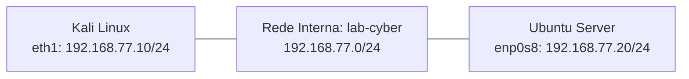

<div align="center">

# Laboratório de Redes e Segurança

**Redes · Linux · Fundamentos de Segurança**

Da configuração do ambiente à investigação de serviços: um registro prático de aprendizagem.

[](#progresso)
[](#ambiente)
[](#ambiente)
[](#escopo)

[Visão geral](#visão-geral) · [Ambiente](#ambiente) · [Diário técnico](#diário-técnico) · [Progresso](#progresso) · [Aprendizados](#aprendizados)

</div>

---

## Visão geral

Este projeto documenta a construção de um laboratório pessoal para estudar redes, Linux e fundamentos de segurança.

A primeira versão conecta Kali Linux e Ubuntu Server em uma rede interna do VirtualBox. Este registro apresenta a configuração do ambiente, os problemas encontrados e os resultados dos testes de comunicação, identificação de serviços e acesso remoto.

### Objetivos

- Interpretar interfaces de rede, endereços IP e tabelas de rotas.
- Compreender a comunicação entre máquinas virtuais.
- Preparar uma rede separada para exercícios de segurança.
- Identificar serviços e analisar os resultados com contexto.
- Praticar documentação técnica e controle de versões com Git e GitHub.

> **Etapa atual:** Rede interna, identificação de serviços e acesso SSH validados.

## Ambiente

| Componente | Configuração observada |
| :--- | :--- |
| Sistema hospedeiro | Windows |
| Memória RAM do computador | 16 GB |
| Plataforma de virtualização | VirtualBox |
| Máquinas virtuais | Kali Linux e Ubuntu Server |
| Adaptador 1 de cada VM | NAT, com instâncias separadas |
| Adaptador 2 de cada VM | Rede Interna — `lab-cyber` |
| IPv4 interno do Kali | `eth1` — `192.168.77.10/24` |
| IPv4 interno do Ubuntu | `enp0s8` — `192.168.77.20/24` |
| Rede do laboratório | `192.168.77.0/24` |
| Serviço identificado | SSH — porta TCP 22 |

Os endereços representam a configuração observada durante os exercícios.

### Topologia do laboratório



As máquinas se comunicam pela rede interna `lab-cyber`.
Cada VM também possui um adaptador NAT separado para conexões de saída.

**Testes realizados do Kali para o Ubuntu:** ping, identificação das portas TCP 22 e 80 e acesso autenticado por SSH.

O diagrama representa a rede interna usada nos testes. A conectividade com a internet não foi validada neste registro.

## Diário técnico

### 01 — Preparação da máquina virtual

A máquina Kali Linux já existia de um curso anterior. Para iniciar este projeto:

1. O adaptador de rede foi alterado de **bridge** para **NAT**.
2. A máquina virtual foi iniciada.
3. O acesso à área de trabalho foi confirmado.

**Motivo da escolha:** utilizar o NAT nesta etapa inicial para permitir conexões de saída pela rede do computador hospedeiro. Naquela etapa, a rede interna ainda seria preparada; sua configuração está registrada na etapa 04.

### 02 — Identificação das interfaces

**Objetivo:** verificar quais interfaces existem, seus estados e endereços.

```bash
ip -br addr
```

**Resumo dos dados IPv4 observados:**

| Interface | Estado exibido | Endereço IPv4 | Interpretação |
| :--- | :--- | :--- | :--- |
| `lo` | `UNKNOWN` | `127.0.0.1/8` | Interface de loopback, usada na comunicação do sistema consigo mesmo. |
| `eth0` | `UP` | `10.0.2.15/24` | Interface ativa que conecta o Kali à rede virtual. |

A saída também apresentou endereços IPv6, que não foram analisados nesta etapa.

**Conclusão:** a interface `eth0` está ativa e possui um endereço IPv4 privado. Isso, isoladamente, não comprova acesso à internet.

### 03 — Identificação das rotas

**Objetivo:** descobrir a rede diretamente conectada e o caminho padrão para outras redes.

```bash
ip route
```

<details>
<summary><strong>Ver saída registrada</strong></summary>

```text
default via 10.0.2.2 dev eth0 proto dhcp src 10.0.2.15 metric 100
10.0.2.0/24 dev eth0 proto kernel scope link src 10.0.2.15 metric 100
```

</details>

#### Interpretação

| Trecho da saída | Significado |
| :--- | :--- |
| `default via 10.0.2.2` | Define o gateway usado quando não existe uma rota mais específica para o destino. |
| `dev eth0` | Indica a interface utilizada pela rota. |
| `src 10.0.2.15` | Indica o endereço de origem preferido nessa rota. |
| `10.0.2.0/24` | Identifica a rede diretamente conectada. |
| `proto dhcp` | Indica que a rota padrão foi configurada por DHCP. |

**Conclusão:** o Kali possui uma rota direta para `10.0.2.0/24` e uma rota padrão pelo gateway `10.0.2.2`.

### 04 — Configuração da rede interna

**Objetivo:** preparar uma interface dedicada à comunicação entre as máquinas do laboratório.

Com o Kali desligado, o Adaptador 2 do VirtualBox foi habilitado em modo **Rede Interna**, com o nome `lab-cyber`. O Adaptador 1 permaneceu em NAT.

No Kali, a segunda interface foi identificada como `eth1`.

#### Problema encontrado

O endereço configurado com `ip addr add` apareceu inicialmente, mas não permaneceu aplicado. Na verificação seguinte:

- A interface `eth1` estava sem IPv4.
- O NetworkManager indicava estado `disconnected`, sem conexão ativa.
- A rota da rede do laboratório não estava presente.

Esses resultados confirmaram a ausência da configuração, mas não determinaram a causa exata de sua remoção.

#### Configuração permanente

Foi criado um perfil no NetworkManager com endereço IPv4 manual e ativação automática:

```bash
sudo nmcli connection add type ethernet ifname eth1 con-name lab-cyber ipv4.method manual ipv4.addresses 192.168.77.10/24 ipv4.never-default yes connection.autoconnect yes
```

Em seguida, o perfil foi ativado:

```bash
sudo nmcli connection up lab-cyber
```

A opção `ipv4.never-default yes` impede que esse perfil seja utilizado como rota padrão IPv4.

#### Validação após reiniciar

Comando:

```bash
ip -4 -br addr
```

Resultado:

```text
lo               UNKNOWN        127.0.0.1/8
eth0             UP             10.0.2.15/24
eth1             UP             192.168.77.10/24
```

Comando:

```bash
ip -4 route
```

Resultado:

```text
default via 10.0.2.2 dev eth0 proto dhcp src 10.0.2.15 metric 100
10.0.2.0/24 dev eth0 proto kernel scope link src 10.0.2.15 metric 100
192.168.77.0/24 dev eth1 proto kernel scope link src 192.168.77.10 metric 101
```

**Conclusão:** o endereço IPv4 e a rota da rede interna permaneceram após reiniciar. A rota padrão continuou pelo adaptador NAT. Naquele momento, a comunicação com outra máquina ainda não havia sido testada; a validação está registrada na etapa 06.

### 05 — Adição do servidor Ubuntu

Foi criada a máquina virtual `ubuntu-lab` com Ubuntu Server e dois adaptadores de rede:

| Interface | Modo no VirtualBox | IPv4 |
| :--- | :--- | :--- |
| `enp0s3` | NAT | `10.0.2.15/24` |
| `enp0s8` | Rede Interna — `lab-cyber` | `192.168.77.20/24` |

O serviço OpenSSH foi selecionado durante a instalação.

O endereço NAT coincide com o do Kali porque cada máquina utiliza uma instância separada do NAT padrão do VirtualBox. A comunicação entre as duas máquinas neste exercício utiliza a rede interna `192.168.77.0/24`.

### 06 — Teste de comunicação

No Kali:

```bash
ping -c 4 192.168.77.20
```

Foram observadas quatro respostas do Ubuntu, com tempos entre `0.251 ms` e `0.372 ms`.

**Conclusão:** houve comunicação entre Kali e Ubuntu pela rede interna. Esse teste não determina quais serviços estão disponíveis.

### 07 — Identificação do SSH

No Kali:

```bash
nmap -sV -p 22 192.168.77.20
```

Trecho do resultado:

```text
PORT   STATE SERVICE VERSION
22/tcp open  ssh     OpenSSH 10.2p1 Ubuntu 2ubuntu3.8 (Ubuntu Linux; protocol 2.0)
```

Interpretação:

- `-p 22` limita a verificação à porta 22.
- `-sV` tenta identificar o serviço e sua versão.
- `open` indica que a porta está aceitando conexões.
- O serviço identificado foi SSH, compatível com a instalação do OpenSSH no Ubuntu.

**Limitação:** apenas a porta TCP 22 foi examinada. A identificação de versão não comprova uma vulnerabilidade.

### 08 — Acesso remoto e confirmação do ambiente

A conexão foi iniciada no Kali:

```bash
ssh netrunner@192.168.77.20
```

Após entrar, foram executados os seguintes comandos na sessão remota:

```text
netrunner@ubuntu-lab:~$ whoami
netrunner
netrunner@ubuntu-lab:~$ hostname
ubuntu-lab
```

**Conclusão:** a sessão utilizou o usuário `netrunner` no servidor `ubuntu-lab`. O Kali atuou como cliente SSH; os comandos da sessão foram executados no Ubuntu.

### 09 — Comparação entre porta aberta e fechada

No Kali, foram verificadas duas portas TCP do Ubuntu:

```bash
nmap -sV -p 22,80 192.168.77.20
```

Resultado principal:

```text
PORT   STATE  SERVICE VERSION
22/tcp open   ssh     OpenSSH 10.2p1 Ubuntu 2ubuntu3.8 (Ubuntu Linux; protocol 2.0)
80/tcp closed http
```

#### Interpretação

- **22/TCP aberta:** o serviço SSH estava acessível. O acesso com o usuário do laboratório já havia sido validado na etapa anterior.
- **80/TCP fechada:** o alvo respondeu, mas não havia serviço aceitando conexões nessa porta.
- O nome `http` associa a porta 80 ao seu uso habitual; não comprova a presença de um servidor web.

### Conclusão da primeira versão

Foi montado um laboratório com Kali Linux e Ubuntu Server conectados pela rede interna `lab-cyber`.

Foram validados:

- Endereçamento e rotas do Kali, incluindo persistência após reiniciar.
- Comunicação do Kali com o Ubuntu.
- Identificação do serviço SSH.
- Acesso remoto autenticado e execução de comandos no Ubuntu.
- Comparação entre uma porta TCP aberta e uma fechada.

**Limitações:** a verificação de serviços ficou restrita às portas TCP 22 e 80. Não foram avaliadas vulnerabilidades, resistência das senhas ou configurações de segurança do SSH. Os resultados não permitem concluir que o servidor é seguro ou vulnerável.

## V2 — Serviço web e estado da porta 80

### Objetivo

Observar como iniciar e parar um servidor web afeta a porta TCP 80 e o acesso pelo navegador.

### Instalação no Ubuntu

Os comandos foram executados no Ubuntu por uma sessão SSH iniciada no Kali:

```bash
sudo apt update
sudo apt install nginx
systemctl is-active nginx
```

A consulta retornou `active`.

### Verificação pelo Kali

```bash
nmap -sV -p 22,80 192.168.77.20
```

A porta 80, que estava fechada no teste da primeira versão, passou a aparecer como aberta.

No navegador do Kali, o endereço abaixo exibiu a página padrão “Welcome to nginx!”:

```text
http://192.168.77.20
```

### Teste com o serviço parado

Na sessão SSH do Ubuntu:

```bash
sudo systemctl stop nginx
```

Após repetir a verificação pelo Kali, a porta 80 apareceu como fechada. O navegador também deixou de acessar a página.

### Reinício do serviço

No Ubuntu:

```bash
sudo systemctl start nginx
systemctl is-active nginx
```

O estado voltou a ser `active`, e a página ficou acessível novamente no navegador do Kali.

### Resultados observados

| Situação | Porta TCP 80 | Acesso pelo navegador |
| :--- | :--- | :--- |
| Antes da instalação | Fechada | Não testado nessa etapa |
| Nginx em execução | Aberta | Página padrão exibida |
| Nginx parado | Fechada | Falha de conexão |
| Nginx iniciado novamente | Não verificada novamente com Nmap | Página acessível novamente |

### Aprendizado

Neste exercício, observei a relação entre um serviço em execução,

### Página própria e análise dos registros HTTP

Acompanhei os acessos ao Nginx no terminal do Ubuntu:

```bash
sudo tail -f /var/log/nginx/access.log
```

No navegador do Kali, acessei `/teste-netrunner` antes de criar o arquivo. O servidor registrou:

```text
192.168.77.10 - - [19/Oct/2026:12:57:43 +0000] "GET /teste-netrunner HTTP/1.1" 404 134
```

Depois de criar o arquivo, o mesmo caminho passou a retornar `200`. Porém, o navegador baixou o arquivo em vez de exibir a página diretamente.

Renomeei o arquivo para incluir a extensão `.html`:

```bash
sudo mv /var/www/html/teste-netrunner /var/www/html/teste-netrunner.html
```

Ao acessar `http://192.168.77.20/teste-netrunner.html`, a página foi exibida diretamente no navegador. O log registrou:

```text
192.168.77.10 - - [19/Oct/2026:13:00:51 +0000] "GET /teste-netrunner.html HTTP/1.1" 200 203
```

Os trechos acima foram abreviados após o campo de tamanho da resposta.

#### O que observei

- O IP `192.168.77.10` identifica o Kali neste laboratório.
- `GET` indica o pedido de um recurso.
- `404` indicou que o caminho solicitado não foi encontrado.
- `200` indicou que a requisição foi atendida com sucesso.
- Um código `200` não garante que o navegador exibiu uma página: também ocorreu quando o arquivo foi baixado.

A porta 80 permaneceu aberta durante esses testes. A resposta HTTP mudou conforme o recurso solicitado estava disponível.

## Progresso

### Preparação e reconhecimento do ambiente

- [x] Iniciar o Kali Linux no VirtualBox.
- [x] Alterar o adaptador de bridge para NAT.
- [x] Consultar interfaces e endereços.
- [x] Identificar a rede diretamente conectada.
- [x] Identificar o gateway padrão.
- [x] Registrar a configuração inicial no README.
- [x] Documentar resultados, limitações e conclusões.

### Rede interna e testes

- [x] Preparar uma rede separada para os exercícios.
- [x] Adicionar uma máquina de laboratório.
- [x] Validar a comunicação entre as máquinas.
- [x] Identificar o SSH e verificar as portas TCP 22 e 80 do Ubuntu.
- [x] Validar o acesso remoto autenticado.

## Aprendizados

| Conceito | Entendimento trabalhado |
| :--- | :--- |
| Interface de rede | É o ponto de conexão do sistema com uma rede física ou virtual. |
| Loopback | Permite que o sistema se comunique consigo mesmo. |
| Endereço IP | Identifica uma interface dentro de uma rede. |
| Prefixo `/24` | Indica que os primeiros 24 bits do endereço IPv4 representam a parte da rede. |
| Gateway padrão | É o próximo salto utilizado para destinos sem uma rota mais específica. |
| Porta aberta | Indica um serviço aceitando comunicação; não confirma, sozinha, uma vulnerabilidade. |

## Escopo

Este repositório registra **atividades de aprendizagem em laboratório** e não representa experiência profissional em pentest.

Os exercícios desta versão foram realizados em máquinas virtuais próprias. Atividades futuras seguirão o mesmo escopo ou utilizarão ambientes expressamente autorizados, com dados fictícios ou públicos. A documentação publicada não deve conter credenciais ou informações confidenciais.

---

<div align="center">

Criado e mantido por [netrunner-k](https://github.com/netrunner-k)

**Observar → entender → praticar → documentar**

</div>
